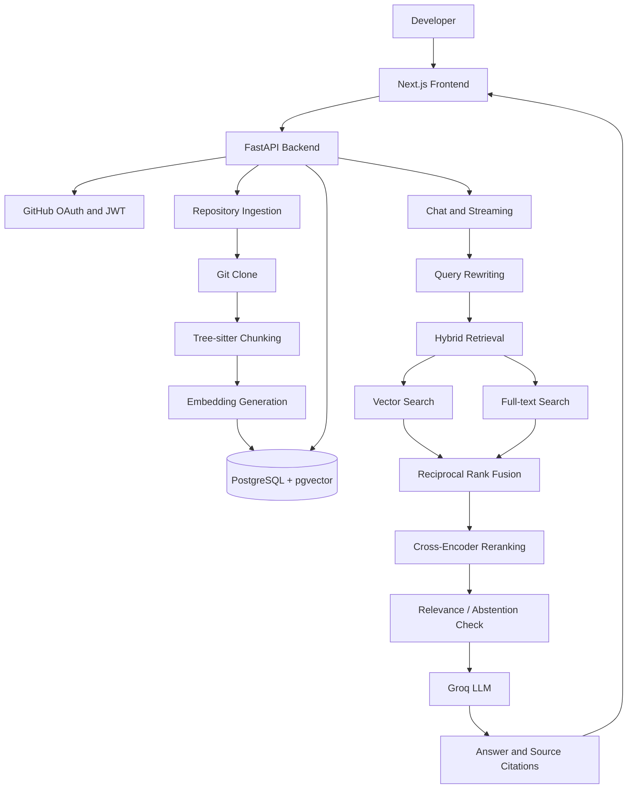

# CodeCompass

**AI-powered GitHub repository assistant that helps developers understand unfamiliar codebases through natural-language questions, hybrid code search, and source-grounded answers.**

CodeCompass indexes GitHub repositories, retrieves relevant code using semantic and lexical search, and uses an LLM to generate answers with file-level citations.

## Features

- **GitHub OAuth authentication** — sign in securely with GitHub.
- **Repository ingestion** — clone and index public GitHub repositories.
- **Background indexing** — track repository indexing status.
- **Syntax-aware chunking** — use Tree-sitter to split source files into meaningful code chunks.
- **Hybrid retrieval** — combine vector similarity and PostgreSQL full-text search.
- **Reciprocal Rank Fusion** — combine retrieval rankings.
- **Cross-encoder reranking** — improve relevance of retrieved code.
- **Query rewriting** — expand questions to improve retrieval.
- **Grounded AI answers** — generate responses using retrieved repository context.
- **Source citations** — navigate to cited files and relevant line ranges.
- **Conversation history** — maintain separate chat sessions for repositories.
- **Contextual follow-ups** — use previous messages to understand follow-up questions.
- **Abstention** — avoid generating answers when retrieval evidence is insufficient.
- **Usage controls** — per-user rate limits and daily estimated token budgets.
- **Streaming responses** — stream generated answers to the frontend.

## Architecture



## Technology Stack

| Layer | Technologies |
|---|---|
| Frontend | Next.js, React, TypeScript, Tailwind CSS |
| Backend | Python, FastAPI, Pydantic |
| Database | PostgreSQL, pgvector |
| ORM | SQLAlchemy (async) |
| Code parsing | Tree-sitter |
| Embeddings | Sentence Transformers |
| Retrieval | Vector search, PostgreSQL full-text search, RRF |
| Reranking | Cross-Encoder |
| LLM | Groq API |
| Authentication | GitHub OAuth, JWT, HttpOnly cookies |
| Streaming | Server-Sent Events (SSE) |
| Infrastructure | Docker, Docker Compose |
| CI | GitHub Actions |
| Testing | Pytest |

## Retrieval Evaluation

Two datasets were evaluated: FastAPI (50 questions) and Requests (50 questions).

| Repository | Retrieval mode | Hit@1 | Hit@5 |
|---|---|---:|---:|
| FastAPI | Vector | 32% | 56% |
| FastAPI | Hybrid | 32% | 62% |
| FastAPI | Hybrid + reranker | **52%** | **86%** |
| Requests | Vector | 68% | 94% |
| Requests | Hybrid | 58% | 84% |
| Requests | Hybrid + reranker | **66%** | **88%** |
| Combined (100 questions) | Vector | 50% | 75% |
| Combined (100 questions) | Hybrid | 45% | 73% |
| Combined (100 questions) | Hybrid + reranker | **59%** | **87%** |

**Evaluation notes:**
- Test files were excluded.
- Hit@1 and Hit@5 measure expected source-file retrieval, not generated-answer correctness.
- Answer accuracy has not yet been measured because answer labels remain unverified.
- These results are provisional and should not be interpreted as independently validated answer accuracy.

## Getting Started

### Prerequisites

- Docker Desktop
- Git
- GitHub OAuth application
- Groq API key

### 1. Clone the repository

```bash
git clone https://github.com/Ashusf90/CodeCompass.git
cd CodeCompass
```

### 2. Configure environment variables

Create the backend environment file:

```bash
cp backend/.env.example backend/.env
```

Configure the backend environment with:
- `GROQ_API_KEY`
- `GITHUB_CLIENT_ID`
- `GITHUB_CLIENT_SECRET`
- A strong, randomly generated `SESSION_SECRET`

Create the root `.env` file with:
- `POSTGRES_PASSWORD`
- `NEXT_PUBLIC_API_URL=http://localhost:8000`

Never commit environment files or API secrets.

### 3. Configure GitHub OAuth

Set the GitHub OAuth application URLs:

- Homepage URL: `http://localhost:3000`
- Authorization callback URL: `http://localhost:8000/api/auth/github/callback`

### 4. Start the application

```bash
docker compose up --build -d
```

Check running services:

```bash
docker compose ps
```

### 5. Access CodeCompass

| Service | URL |
|---|---|
| Frontend | http://localhost:3000 |
| Backend API | http://localhost:8000 |
| API documentation | http://localhost:8000/docs |
| Health check | http://localhost:8000/health |

## Running Tests

Activate the backend virtual environment and run:

```bash
cd backend
source venv/bin/activate
pytest -q
```

The project also uses GitHub Actions to run backend tests against PostgreSQL with pgvector and build the frontend on pushes and pull requests to `main`.

## Project Structure

```text
CodeCompass/
├── .github/
│   └── workflows/
│       └── ci.yml
├── backend/
│   ├── app/
│   │   ├── api/
│   │   ├── core/
│   │   ├── db/
│   │   ├── schemas/
│   │   └── services/
│   ├── tests/
│   ├── Dockerfile
│   └── requirements.txt
├── frontend/
│   ├── src/
│   │   └── app/
│   ├── Dockerfile
│   └── package.json
├── evaluation/
├── scripts/
├── docker-compose.yml
└── README.md
```

## Current Status

- [x] GitHub repository ingestion and indexing
- [x] Tree-sitter-based code chunking
- [x] Embedding generation and vector retrieval
- [x] Hybrid search and reranking
- [x] Query rewriting and abstention
- [x] Retrieval evaluation harness
- [x] GitHub OAuth and repository ownership checks
- [x] Persistent chat history and follow-up context
- [x] SSE streaming and source citations
- [x] Rate limiting and daily token budgets
- [x] Next.js chat workspace and source viewer
- [x] Dockerized application
- [x] Automated CI with passing backend tests and frontend build
- [ ] Production deployment
- [ ] Production monitoring and validated answer-accuracy evaluation

## Repository

[GitHub: Ashusf90/CodeCompass](https://github.com/Ashusf90/CodeCompass)